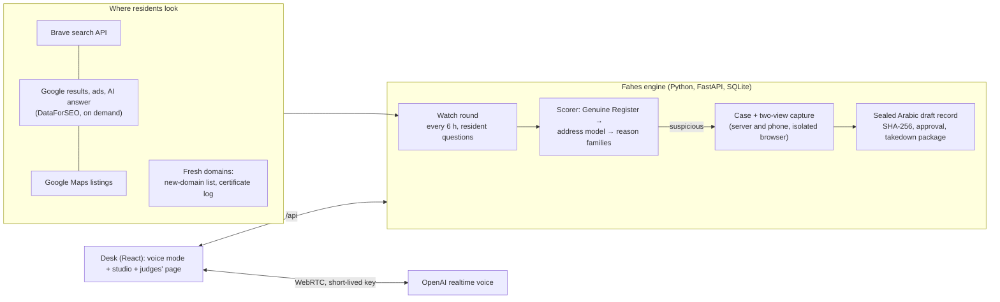

# Fahes (فاحص), "the examiner"

**Proactive monitoring of fake links for Abu Dhabi Police.** Fahes watches where residents look for help (search
results, Google ads, Google's AI answer, Maps listings), scores every link it finds with clear reasons in Arabic and
English, sees through cloaking, and prepares a sealed draft record for takedown. A voice-first desk gives the duty
officer all of it in a few words.

> فاحص: رصد استباقي للروابط الوهمية لشرطة أبوظبي، بأسباب واضحة بالعربية والإنجليزية ومسودة محضر مختومة جاهزة للإزالة.
> (Fahes: proactive monitoring of fake links for Abu Dhabi Police, with clear reasons in Arabic and English and a sealed draft record ready for takedown.)

Team Fortress · SCAMSHIELD AI hackathon (42 Abu Dhabi × Abu Dhabi Police), November 2026.

---

## For judges (start here)

### 1. The live app, no passcode

**https://fahes.fly.dev**

- **Voice:** press «تكلّم مع فاحص» / "Talk to Fahes" and speak Arabic or English, or type in the bottom field. Try "good morning, what do we have today?", "open the first one", "seal it", "show it on the phone", or paste a link.
- **Studio** (top switch): every feature by hand.
- **For judges** (last item in the studio's side menu, or https://fahes.fly.dev/?mode=studio&page=judges): paste links or upload a `.txt` or `.csv` file, see each verdict with its reasons, and download a CSV. It uses the same scoring as the command below.
- **English:** the button at the top right switches to English.

### 2. Score a file of links offline (no keys, no internet)

Python 3.12 or newer.

```bash
git clone https://github.com/maaz-m-k/fahes.git
cd fahes
python3.12 -m venv .venv && . .venv/bin/activate
pip install .
istibaq score links.txt --out results.csv
```

- **Input:** one link per line, or a CSV with a `url` column. Use `-` to read from standard input.
- **Options:** `--mode judging` (default) or `--mode officer`, and `--format csv` (default) or `--format jsonl`.

**Output columns:**

| Column | Content |
|---|---|
| `link` | the link exactly as given |
| `is_fraud` | `yes` / `no`. Use this for precision and recall |
| `score` | 0 to 1 |
| `verdict` | `green` (official), `grey` (not official, not accused), `red` (suspected fake, at least two independent reasons) |
| `reasons` | `code: Arabic / English`, separated by ` \| ` |
| `model_version` | address model and its training cut date |
| `scored_at` | time, ISO-8601 UTC |

**The two modes:**
- `judging` gives the most catches: `is_fraud = yes` when the link is not green and scores 0.9 or more.
- `officer` gives a quiet desk: `is_fraud = yes` only for red, which needs an independent reason besides the address pattern.

### 3. Full mode, online

```bash
pip install '.[service]'
istibaq score links.txt --online --out results.csv
```

`--online` follows short links and redirects hop by hop, judging every hop through an address guard, and adds the domain's registration age (RDAP).

The live-page checks run on the server, when a case is captured:
- two views (a server and a phone) to see through cloaking;
- human-check walls;
- the brand a page claims, compared with the register;
- an optional AI reading of that brand, when `OPENROUTER_API_KEY` and `ISTIBAQ_AI_LAYER=1` are set.

Do not run `--online` on a laptop with suspect links: it fetches them.

### 4. The whole app in Docker

```bash
docker build -t fahes . && docker run --rm -p 8080:8080 fahes
```

Then open http://localhost:8080. Without keys, scoring, cases and the judges' page work. Voice and the search rounds need the keys listed under [Run it yourself](#run-it-yourself).

---

## What Fahes does, mapped to the judging criteria

| Criterion | What Fahes does |
|---|---|
| **Detection accuracy (30%)** | Scores every link through a register of the real Abu Dhabi, an address model, and independent reason families. Red needs two independent reasons. Follows redirects and short links, and sees through cloaking by opening a suspect page as a server and as a phone. Measured on a sealed test: see [Accuracy, honestly](#accuracy-honestly) |
| **Early detection and coverage (25%)** | A watch round every 6 hours asks the questions residents ask (fines, bills, helplines, banks, government services) in Arabic and English. It covers Brave search results, **Google results, Google ads and the links cited by Google's AI answer** (DataForSEO, on demand), and **Google Maps listings**, including fake helpline phone numbers. Fresh domains come from the newly-registered-domains list and certificate logs |
| **Explainability and actionability (20%)** | Every verdict has a 0–1 score and plain reasons in Arabic and English, with evidence. Each case gets a **sealed Arabic draft record (SHA-256)** that the officer approves by voice or click; changing one letter breaks the seal. The takedown package is prepared (never sent automatically), and the judges' page exports a CSV |
| **UAE relevance and innovation (15%)** | The **Genuine Register** of Abu Dhabi and UAE government, banks, telecoms and utilities, each entry with its source and date. Arabic first. A voice-first desk in the style of Mira, the UAE government's assistant: the officer talks, Fahes shows only what matters |
| **Feasibility and presentation (10%)** | Live at https://fahes.fly.dev as one small app (Python engine + web desk). Costs are logged and projected in the app. Honest labels on every part, and a [route to a police pilot](#trade-offs-what-was-left-out-and-the-route-to-a-pilot) |

---

## Accuracy, honestly

From [`docs/accuracy.md`](docs/accuracy.md): **sealed test v2**.
- 1,011 fresh fakes, one per site, reported after the model's training cut.
- 5,935 real links: real UAE pages and names, real search results, popular sites and popular subdomain hosts.
- The known-bad list is switched off, so nothing is a lookup.
- Ranges are 95% Wilson ranges, counted by registered domain.

| Setting | Fakes caught | False alarms on real links | Right when it says "fraud" |
|---|---|---|---|
| Judges (`judging`) | **72.8%** (69.5–76.0%) | 384 of 5,935 (**6.5%**, 5.8–7.2%) | 65.7% on this mix (6 reals per fake); 91.8% at half and half |
| Officer (`officer`) | **21.8%** (18.9–25.0%) | 10 of 5,935 (**0.17%**, 0.08–0.32%) | **95.7%** (92.2–97.6%) |
| Judges, live app (AI second opinion on) | **78.5%** (75.3–81.3%) | 375 of 5,935 (**6.3%**, 5.6–7.1%) | 67.9% on this mix; 92.6% at half and half |

**Two numbers for the judges' setting:**
- **72.8%** is the address alone: `istibaq score` with no key, offline, pure code.
- **78.5%** is the live app (server and "For judges" page). There a language model gives a second opinion on the
  uncertain links only, those scoring 0.70–0.99 that the register has not turned green. A real UAE page is never sent.
  - On the same sealed test, real UAE pages stayed at 0 false alarms. Popular-site false alarms went from 3 to 9,
    while false alarms on popular subdomain hosts fell from 379 to 364.
  - The officer setting is unchanged: the AI never makes a link red.
  - Opt in on the command line with `istibaq score links.txt --ai` (needs `OPENROUTER_API_KEY`).
  - Details, and how the model and settings were chosen without touching the test, are in
    [docs/accuracy.md](docs/accuracy.md#ai-second-opinion-adopted-on-the-live-app).

**What is measured:**
- Bare addresses only, and no real UAE page is flagged in either setting.
- Almost all remaining false alarms in the judges' setting are real pages on free website builders (`*.github.io`, `*.pages.dev`). There the address alone cannot tell real from fake, so they are flagged, but never red.

**What is not measured:**
- The online levers (redirects, live brand, Maps phones) need live pages. They are tested with recorded fakes only.
- Public feeds hold almost no UAE-targeted fakes, so the 25 UAE look-alikes are a stress check that is not counted.
- The officer catch leans on the offline domain-age list, whose dates overlap the test's fakes. Read it as a best case.

**Known misses:**
- fakes on hosting companies' customer subdomains;
- fakes whose only signal is a word inside a longer word;
- anything a week-old domain list has not seen yet (refresh it with `scripts/data/refresh_nrd.sh`).

We do not quote public benchmark numbers as our accuracy. The release gate is `python -m istibaq.eval.gate`.

---

## Architecture



- **One app:** the engine serves the desk at `/` and the API under `/api`, on one Fly.io machine with a volume for SQLite, captures and footage.
- **Code layout:**
  - engine: `istibaq/` (scoring core in `istibaq/core/`, watch and capture in `istibaq/watch/` and `istibaq/capture/`);
  - desk: `web/`;
  - more detail: [`docs/service.md`](docs/service.md), [`docs/watch.md`](docs/watch.md), [`docs/model.md`](docs/model.md).

### Model choices

- **Genuine Register first.** An official address is green before any model runs. Each entry has a source and a date, and officers' "not a scam" / "licensed" marks are applied on top.
- **Address model:**
  - character 3-to-5-gram logistic regression over the host, then gradient boosting (LightGBM) over that score plus address facts;
  - trained on PhishTank reports before 17 Nov 2026 and on popular sites;
  - it never uses path length, scheme, `www`, trailing slash or popularity rank;
  - it works on dead links, because it needs only the address.
- **Independent reason families:**
  - brand mismatch: typos, look-alike letters, brand plus a word;
  - disguised addresses, new domains, free hosts, short links and IP hosts;
  - online: redirects, the difference between the two views, the live page's brand, human-check walls, a payee not in the register.
- **Rules decide the verdict.** Red needs two independent reasons.
- **The AI layer** (OpenRouter) is optional and used only to read which brand a live page claims. It can add a reason, never clear a link, and the register decides who owns a brand. Page text addressed to an AI is stripped.
- **The AI second opinion** (OpenRouter, Gemini 2.5 Flash-Lite) is on for the live app's scoring.
  - It reads only uncertain links and never sees the checker's score.
  - It cannot touch a register-green, licensed or popular site, and it never clears or makes a red verdict.
  - Answers are cached by address and every call goes to the cost log.
  - Above a $1 daily cap (`ISTIBAQ_AI_DAILY_USD`), or with no key, scoring is pure code.
- **Voice:** OpenAI gpt-realtime-2.1 over WebRTC, using a short-lived key minted by the server. The model calls tools; every number and verdict it speaks comes from the engine.

### Privacy design

- **No personal data:** no resident or officer data is collected or stored, and the demo cases use reserved, made-up addresses (`.test`, `.example`).
- **Keys stay on the server:** they live only in server environment variables and are never logged or returned. The browser gets only a short-lived (10-minute) voice key.
- **Suspect pages are handled at arm's length:**
  - they are opened only in the server's isolated capture browser;
  - every hop passes an address guard: no private or local addresses, and nothing but http or https;
  - Fahes never types, submits or solves a challenge on them;
  - typing happens only in a search engine's own search box;
  - `ISTIBAQ_CAPTURE_LOCAL_ONLY=1` keeps a laptop to 127.0.0.1.
- **Grey sites** (not official, not accused) appear as quiet dots; their names show only on tap.
- **Nothing is sent outward.** Takedown packages are prepared for the officer to decide.

---

## Data and credits

| Data or service | Use | Licence / credit |
|---|---|---|
| [PhishTank](https://phishtank.org) | training fakes (before the cut), sealed test; fresh links each round when its list answers without a key | CC BY-SA 4.0, credit PhishTank |
| [OpenPhish community feed](https://openphish.com/phishing_feeds.html) | known-bad hosts, held-out test; fresh scam links each round (the red cases on the desk) | credit OpenPhish |
| [Tranco list](https://tranco-list.eu) | popular sites (never accused), training reals | Le Pochat et al., NDSS 2019 |
| [hagezi/nrd](https://github.com/hagezi/nrd) | newly registered domains (7 days) | GPL-3.0, credit hagezi |
| Public certificate logs, [crt.sh](https://crt.sh) | live new-certificate rate, register evidence | public data |
| [RDAP](https://about.rdap.org) (rdap.org) | domain age (online) | public data |
| Public sitemaps of adpolice.gov.ae, mohre.gov.ae, bankfab.com | real UAE pages for training and tests | public pages |
| [Brave Search API](https://brave.com/search/api/) | the watch round's web results | paid API |
| [Google Places API](https://developers.google.com/maps/documentation/places/web-service) | Maps listings (names, phones, websites) | paid API |
| [DataForSEO](https://dataforseo.com) | Google results, ads and AI-answer links (on demand, hard spend limits) | paid API |
| [OpenAI Realtime](https://platform.openai.com/docs/guides/realtime) (gpt-realtime-2.1) | voice | paid API |
| [OpenRouter](https://openrouter.ai) | optional AI layer; typed understanding in development | paid API |
| [Playwright](https://playwright.dev) / Chromium, [FFmpeg](https://ffmpeg.org) | two-view capture, recorded footage | Apache-2.0 / LGPL |
| FastAPI, scikit-learn, LightGBM, tldextract, React, Vite | engine and desk | open source |

Snapshot dates and files: [`istibaq/data/snapshots/SOURCES.md`](istibaq/data/snapshots/SOURCES.md).

> **Warning:** the known-bad list and the test set contain live scam links. Never open them in a browser.

---

## Where the cases on the desk come from

- **Search results, ads and Maps listings** from each watch round. A case is opened only for a red link, or a grey
  link with a reason saying it imitates an official brand or body. Ordinary blogs and directories stay as scored
  results in the round. Older grey cases without such a reason are archived when the server starts, not deleted.
- **Public scam lists, every round** (and on "Run now"): up to 10 fresh links from the OpenPhish community feed
  (and PhishTank when its list answers without a key), links that imitate UAE or Gulf brands first. Each link is
  scored, captured on the server from two views, and kept as a case only if it comes out red. Links that do not load
  are recorded as dead in the round. The case shows its source as "public scam list: OpenPhish (credited)".
  Off with `ISTIBAQ_PUBLIC_LISTS=0`; the number per round is `ISTIBAQ_PUBLIC_LISTS_PER_ROUND`.
- **Scale numbers** (new certificates, new domain names and the look-alikes among them) are counted in the
  background when the server starts and every hour (`ISTIBAQ_FEEDS_EVERY`, seconds), kept on the volume, and served
  at once with "updated N minutes ago". Right after a first start they say "warming up" for a few minutes.
- **Facts to know:** approval is by click or voice (UAE PASS in a pilot); the phone view is an iPhone emulation on
  the server, not a real phone on a UAE SIM; drill timelines are examples; the look-alike pages in the recorded
  footage are synthetic pages on reserved names.

---

## Trade-offs, what was left out, and the route to a pilot

**Trade-offs:**
- **Two settings:** most catches (`judging`) or a quiet desk with few false alarms (`officer`). The desk uses officer mode.
- **Google results and ads:** only on demand, with hard spend limits, because licensed Google data is paid and Google forbids scraping.
- **Hosting:** the server runs in Frankfurt (`fra`), because Fly.io has no UAE region.
- **Open desk:** the live desk is open to the public with no passcode, on the team lead's choice. The risk is bounded by a per-visitor scoring rate, a batch size limit, and switches that turn voice (`ISTIBAQ_VOICE=0`) or paid searches (`ISTIBAQ_PAID=0`) off.

**Left out:**
- real police accounts and UAE PASS sign-in;
- real phones on du or e& SIMs;
- sending takedowns outward;
- a light theme;
- a UAE-targeted fake test set (public feeds hold almost none).

**Route to a police pilot:**
- UAE hosting for the engine and its data;
- a data partnership with Google for ads and Maps (instead of a paid reseller);
- officer accounts with UAE PASS;
- a dedicated phone-view capture on UAE networks;
- a feedback loop where officers' marks and approved cases retrain the model on UAE fakes.

---

## Run it yourself

**Engine** (Python 3.12):

```bash
python3.12 -m venv .venv && . .venv/bin/activate
pip install -e '.[dev]'
python -m playwright install chromium        # for capture and recording
uvicorn istibaq.api.app:create_app --factory --port 8080
pytest                                        # engine tests
```

**Desk** (Node 22):

```bash
cd web && npm install
npm run dev                                   # the desk on a built-in fake engine
ISTIBAQ_ENGINE_URL=http://127.0.0.1:8080 VITE_ENGINE=http npm run dev   # the desk on your engine
npm test && npm run build
```

**Environment variables** (names only; read only from the environment):
- **Keys:**
  - `OPENAI_API_KEY`: voice;
  - `BRAVE_API_KEY`, `GOOGLE_PLACES_API_KEY`: the watch round;
  - `DATAFORSEO_LOGIN`, `DATAFORSEO_PASSWORD`, with `ISTIBAQ_DATAFORSEO=1`: the Google check;
  - `OPENROUTER_API_KEY`, with `ISTIBAQ_AI_LAYER=1`: the AI layer;
  - `ISTIBAQ_OFFICER_TOKEN`: maintenance endpoints only.
- **Switches:**
  - `ISTIBAQ_SCHEDULE=1`: a round every 6 hours;
  - `ISTIBAQ_RECORD_FOOTAGE=1`: record footage;
  - `ISTIBAQ_VOICE=0`, `ISTIBAQ_PAID=0`: turn voice or paid searches off.

The full list is in [`docs/service.md`](docs/service.md).

**Deploy:** `scripts/deploy.sh` (Fly.io app `fahes`, region `fra`, a volume at `/data`).
